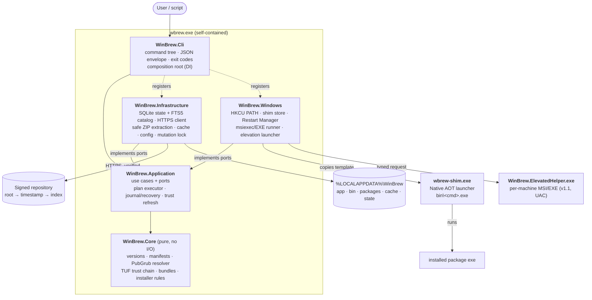
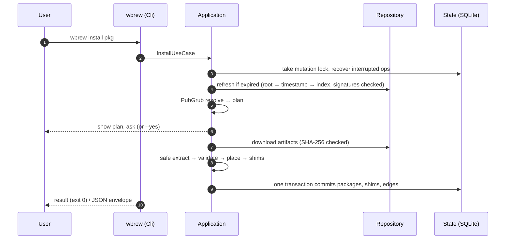

# WinBrew — planning prompts + implementation

**Version:** 2.3.1 (2026-11-03) · **Status:** all phases (0, A–F)
implemented; verified on the Linux dev host (`docs/checkpoints/phase-f.md`).
**CI:** green on Windows x64 and ARM64 (unit, integration, real Native AOT
shim, published-zip checks) and Linux. **Not yet released:** code signing,
a production repository + root keys, the self-update feed and the HTTPS
end-to-end suite are open blockers — see `docs/release-readiness.md`.

This private repository holds BOTH:

1. **The phased implementation prompt set** for **WinBrew** (`wbrew`), an
   independent, Windows-native CLI package manager on .NET 10 — the
   `PROMPT.md` / `phases/` / `PLAN.md` / `RATIONALE.md` / `CHANGES.md` /
   `PROBES.md` file set described below.
2. **The implementation itself** (merged 2026-11-05, Phase A src
   sub-session): `WinBrew.sln` + `src/` + `tests/` + `schemas/` at the
   repo root, exactly per the A5 tree. Build with the pinned SDK
   (`global.json`): `dotnet build -c Release` (warnings are errors),
   `dotnet test`, per-RID restore `dotnet restore -r win-x64|win-arm64`.
   Design decisions and evidence: `docs/adr/`, phase checkpoints:
   `docs/checkpoints/`.

Conceptual references (no code or format compatibility, no
affiliation): Homebrew (UX and command vocabulary), Scoop (per-user
portable installs and the shim model), winget manifest schema (prior
art), The Update Framework (trust model), PubGrub (dependency
resolution), Cargo's sparse index (catalog model).

## Architecture

Dependencies point inward. The CLI is the composition root, and the
Infrastructure and Windows adapters implement the Application's ports. Core is
pure domain code with no I/O. Details: [docs/architecture.md](docs/architecture.md).



What happens on `wbrew install <pkg>`:



## User manual

Installation, first steps, everyday commands, bundles, installer packages,
configuration, scripting and troubleshooting:
**[docs/user-manual.md](docs/user-manual.md)**.

## Quick start (once a release exists)

```powershell
# 1. Download wbrew-<ver>-win-x64.zip (or -win-arm64) and SHA256SUMS.txt from the release page,
#    verify the hash, extract anywhere, then:
.\wbrew.exe self install --modify-path      # copies itself to %LOCALAPPDATA%\WinBrew, adds bin\ to PATH
# 2. In a new shell: add a repository after verifying its root key fingerprint out of band
wbrew repo add <name> https://<repository-url> --trust-root <fingerprint>
# 3. Find, install, run, upgrade, remove
wbrew search <text>
wbrew install <package>          # shows the full plan; --yes approves it
<command> --help                 # installed commands run through shims in bin\
wbrew upgrade
wbrew uninstall <package>; wbrew autoremove
# 4. Reproduce a setup elsewhere
wbrew bundle export --file dev.json            # also writes dev.lock.json
wbrew bundle install --file dev.json --locked
```

Documentation: `docs/user-manual.md` (install + usage), `docs/architecture.md`, `docs/cli-reference.md` (commands,
exit codes, JSON), `docs/manifest-spec.md`, `docs/repository-trust-spec.md`,
`docs/package-author-guide.md`, `docs/security-model.md`,
`docs/threat-model.md`, `docs/recovery-troubleshooting.md`,
`docs/known-limitations.md`, `docs/release-checklist.md`, ADRs in
`docs/adr/` (index: `docs/adr/README.md`). PowerShell completion:
`scripts/wbrew-completion.ps1`.

## File routing — what each session receives

| File | Contents | Sent to |
|---|---|---|
| `PROMPT.md` | Part A — the design (A1–A19, D1–D11); Part C — report templates | **Every** session |
| `phases/phase-0.md` | Phase 0 — plan, default decisions, probes, schema v1 | Phase 0 session |
| `phases/phase-a.md` … `phases/phase-f.md` | One phase prompt each | Its own session only |
| `RATIONALE.md` | Why each decision was made | Phase 0 and Phase F only |
| `CHANGES.md` | Changelogs, review traceability | Never (owner only) |
| `PROBES.md` | Phase 0 external-probe pre-work (dated answers + sources) | Never (owner only) |
| `PLAN.md` | Phase 0 plan — schema v1, TFMs, checkpoints, phase estimates (**APPROVED** 2026-11-05) | Never (owner only) |
| `docs/checkpoints/` | Phase checkpoint reports (session handoffs) | Next phase session |

## Session rules

- Start each session with `PROMPT.md` + exactly **one** phase file +
  the previous phase's checkpoint report.
- Run the phases in order: **0, A, B, C, D, E, F** — one phase per
  session. D1 explains why E (v1.1) precedes F (release hardening).
- Phases A and B split into `src` / `tests` sub-sessions by default.
- A phase counts as complete only after its test sub-session passes.

## Phase map

| Phase | Deliverable |
|---|---|
| 0 | Plan, default decisions, probes (ARM64 runners, signing route, System.CommandLine 2.0), SQLite schema v1 |
| A | CLI scaffolding, config, JSON schemas, SQLite + migrations, mutation lock, `doctor`, FTS5 probe |
| B | Secure portable lifecycle: HTTP client, cache, archive defenses, Native AOT shim, journal/recovery, `self install` |
| C | PubGrub resolver, architecture selection/re-selection, pins, cycles, upgrade compensation |
| D | Simplified-TUF trust, sparse-index catalog, `repo add/list/remove`, `update`, bundles, `self update`/`self uninstall` |
| E (v1.1) | MSI/EXE installers, elevated helper (refuse-never-adopt), `self uninstall` refusal |
| F | Documentation, CI/release workflows, SBOM, signing, release-readiness report |

## Owner tools

- `mindmap.html` — interactive map of the spec, open in a browser.
  Root + six branches (files, decisions, v2.3.1 patch, phases,
  security pillars, session rules); click any card for its detail
  bullets, legend chips fold branches. Owner-side only — it is not
  part of the file routing above and is never sent to sessions.

## Provenance

v2.0 (2026-11-01) → v2.3 through two review rounds (30 + 18 findings,
all addressed and verified). v2.3.1 is a planning-consistency patch
(phase order vs D1, phase assignments, `phases/` layout, bundle
`--locked` syntax, helper request transport, Phase 0 probes). Full
history and traceability: `CHANGES.md`. Decision rationale:
`RATIONALE.md`.
